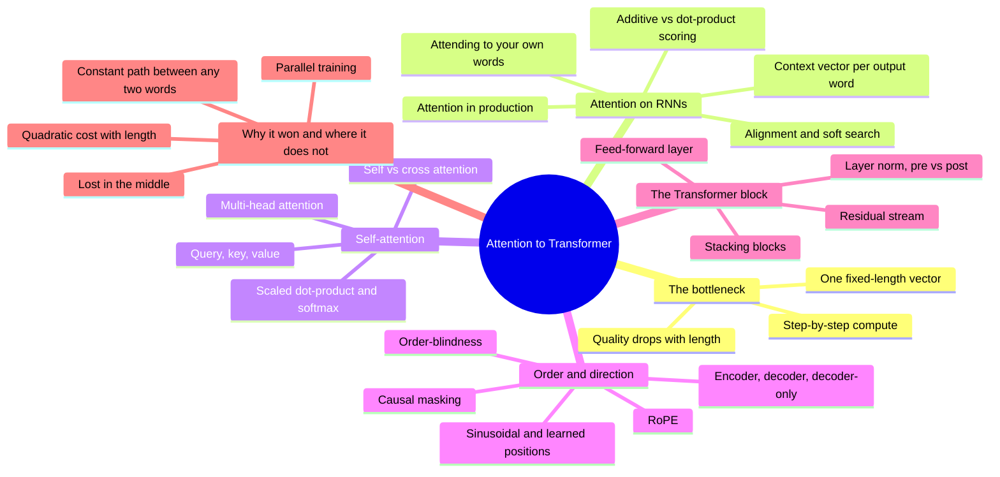

# Attention → Transformer: overview, 30,000 ft to 10,000 ft

Drafted by the assistant from `resources.md`. It stops at 10,000 ft: what the pieces are and how they relate, not the full mechanics.

## 30,000 ft: what it is

Attention lets a model, at each step, look back over every earlier word and take a weighted mix of the ones that matter, instead of relying on one memory carried forward. It was first bolted onto LSTM translators (2014) to stop them squeezing a whole sentence into a single vector. In 2017 the Transformer removed the recurrence entirely and built the whole model from attention plus small per-word layers. Because nothing has to be processed in order, it trains in parallel on GPUs, which is what made today's large language models possible.

## 20,000 ft: the six main topics

1. **The bottleneck.** Why encoder-decoder LSTMs broke on long sentences.
2. **Attention on RNNs.** The 2014–2016 fix: let the decoder look back at every input word.
3. **Self-attention.** Every word looks at every other word in the same text, via queries, keys and values.
4. **Order and direction.** Attention ignores word order and can see the future, so position and masking are added.
5. **The Transformer block.** Attention plus feed-forward, wrapped in residuals and normalization, stacked many times.
6. **Why it won, and where it doesn't.** Parallel training and short paths, at the price of quadratic cost and uneven use of long inputs.

## 10,000 ft: subtopics

### 1. The bottleneck
- **One fixed-length vector:** the encoder compresses the entire source sentence into one vector the decoder must work from. (R2, R1, R18)
- **Quality drops with length:** translation quality falls quickly as sentences get longer. (R3, R4, R36)
- **Step-by-step compute:** each word waits for the previous one, so training can't be spread across a sentence. (R8, R28)

### 2. Attention on RNNs
- **Alignment and soft search:** for each output word, score every input word and focus on the relevant ones. (R1, R18, R21)
- **Additive vs dot-product scoring:** a small network scores pairs (Bahdanau) or a plain dot product does (Luong). (R1, R5, R22, R35)
- **Context vector per output word:** a fresh weighted mix of encoder states at every decoding step, replacing the single vector. (R1, R18)
- **Attention in production:** Google Translate's 2016 system used stacked LSTMs plus attention and residuals. (R6)
- **Attending to your own words:** intra-attention lets a reader link a word to its own earlier words. (R7)

### 3. Self-attention
- **Query, key, value:** each word asks a question (query), advertises what it holds (key) and offers content (value). (R8, R19, R23, R29)
- **Scaled dot-product and softmax:** query-key similarity, scaled down, turned into weights that sum to one. (R8, R31, R30)
- **Multi-head attention:** several attention patterns run side by side, each free to track a different relationship. (R8, R19, R23, R31)
- **Self vs cross attention:** words attending within one text, vs the decoder attending to the encoder's text. (R31, R27)

### 4. Order and direction
- **Order-blindness:** attention treats the input as a set; "dog bites man" and "man bites dog" look alike without help. (R27, R24)
- **Sinusoidal and learned positions:** add a position signal to each word's vector. (R8, R32)
- **RoPE:** rotate queries and keys by position so scores depend on relative distance; standard in modern LLMs. (R12)
- **Causal masking:** block attention to future words so next-word prediction can't cheat. (R8, R27, R31)
- **Encoder, decoder, decoder-only:** the original translator had both halves; GPT-style models keep only the masked decoder. (R14, R33, R15)

### 5. The Transformer block
- **Feed-forward layer:** a small network applied to each word separately after attention; holds most parameters. (R8, R13, R27)
- **Residual stream:** each sub-layer adds its output to a running vector rather than replacing it. (R9, R15, R6)
- **Layer norm, pre vs post:** normalization keeps training stable; where it sits changes how easy training is. (R10, R11)
- **Stacking blocks:** the same block repeated many times, each refining the representation. (R8, R24, R25, R34, R26)

### 6. Why it won, and where it doesn't
- **Parallel training:** all positions computed at once; trained in a fraction of earlier models' cost. (R8, R19)
- **Constant path between any two words:** one attention step links any pair, however far apart. (R8, R20)
- **Quadratic cost with length:** every word compares with every other, so time and memory grow with length squared. (R16)
- **Lost in the middle:** long-context models use the start and end of their input better than the middle. (R17)
