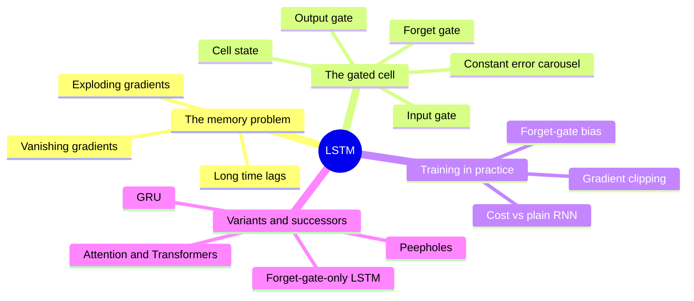

# LSTM: overview, 30,000 ft to 10,000 ft

Drafted by the assistant from `resources.md`. It stops at 10,000 ft: what the pieces are and how they relate, not the full mechanics.

## 30,000 ft: what it is

LSTM is a recurrent neural network built to remember things across long sequences. Plain RNNs lose the training signal after a few dozen steps. LSTM adds a separate memory that changes by small, controlled edits, so information and gradients can survive hundreds of steps. It was the default sequence model for speech, handwriting and translation until attention-based models replaced it.

## 20,000 ft: the four main topics

1. **The memory problem.** Why plain RNNs can't learn long-range dependencies.
2. **The gated cell.** The architecture that fixes it.
3. **Training in practice.** What it takes to make it work.
4. **Variants and successors.** What was tried next, and what replaced it.

## 10,000 ft: subtopics

### 1. The memory problem
- **Vanishing gradients:** the training signal shrinks with every step back in time. (R3, R1)
- **Exploding gradients:** the same mechanism can make it blow up instead. (R3)
- **Long time lags:** the tasks that expose the problem, such as recalling something from 100+ steps earlier. (R1, R8)

### 2. The gated cell
- **Cell state:** a memory vector updated by addition rather than overwritten. (R1, R9)
- **Gates:** small learned valves (forget, input, output) that decide what to drop, write and show. (R2, R9)
- **Constant error carousel:** the original design's trick for letting the training signal pass through unchanged. (R1)

### 3. Training in practice
- **Forget-gate bias:** an initialisation detail that changes results a lot. (R5, R2)
- **Gradient clipping:** still needed, because LSTM doesn't stop explosions. (R3)
- **Cost:** about four times the parameters and compute of a plain RNN. (R4)

### 4. Variants and successors
- **What matters in the cell:** large ablations show the forget gate does most of the work. (R4, R5, R6)
- **GRU:** a lighter gated design that performs comparably. (R5)
- **Attention and Transformers:** removed the step-by-step bottleneck. (no resources yet)
